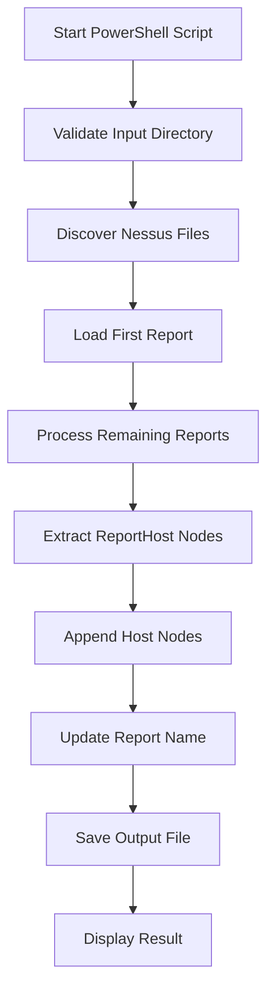

# Nessus Merge Tool

A lightweight, single-file PowerShell utility designed to consolidate multiple Tenable Nessus (`.nessus` v2) XML scan exports into a single unified report file.

---

## Table of Contents

- [Project Overview](#project-overview)
- [Key Features](#key-features)
- [Why This Tool Exists](#why-this-tool-exists)
- [Prerequisites](#prerequisites)
- [Installation](#installation)
- [Quick Start](#quick-start)
- [Usage Examples](#usage-examples)
- [Parameter Reference](#parameter-reference)
- [Architecture Overview](#architecture-overview)
- [Nessus XML Concepts](#nessus-xml-concepts)
- [Processing Flow](#processing-flow)
- [Example Terminal Output](#example-terminal-output)
- [Limitations](#limitations)
- [Troubleshooting](#troubleshooting)
- [Security and Privacy](#security-and-privacy)
- [Project Structure](#project-structure)
- [Future Improvements](#future-improvements)
- [License and Disclaimer](#license-and-disclaimer)

---

## Project Overview

During vulnerability assessments and penetration tests, security practitioners frequently run scans across multiple network segments, cloud environments, or time windows. This often leaves analysts with several separate `.nessus` scan files.

Reviewing multiple files individually or importing them one by one into reporting platforms can be cumbersome. The **Nessus Merge Tool** provides a simple, reliable command-line script (`NessusMerge.ps1`) that consolidates all host records from individual `.nessus` files into a single report for unified review or attempted re-import into Nessus.

---

## Key Features

The features documented below reflect the actual implementation in `NessusMerge.ps1`:

- **Automatic Scan Discovery**: Locates all `.nessus` files within the target directory.
- **Configurable Input Folder**: Specify any directory via `-FilePath`, or default to the current working directory.
- **Configurable Output File**: Define a custom filename or destination path via `-OutputFileName`.
- **Custom Report Name**: Update the internal `<Report name="...">` attribute via `-ReportName`.
- **Host-Record Appending**: Reads each report's `<ReportHost>` nodes and appends them to the base report document.
- **Informative Colored Terminal Output**: Displays color-coded terminal messages for progress (cyan), host additions (green), warnings (yellow), and errors (red).
- **Hardened XML Parser**: Prohibits DTD processing (`DtdProcessing.Prohibit`) and disables external entity resolution (`XmlResolver = $null`) to prevent XML External Entity (XXE) attacks.
- **Input File Preservation**: Input scans are opened in read-only streams and remain unchanged.

---

## Why This Tool Exists

Large networks are typically scanned in batches—divided by subnets, physical locations, scan windows, or credentials. Each scan export yields an independent `.nessus` XML file. Managing these fragmented files manually introduces administrative overhead when generating deliverables, conducting audits, or re-importing scan results into tools that accept consolidated Nessus files.

```text
scan-01.nessus
scan-02.nessus
scan-03.nessus
       |
       v
Nessus Merge Tool (NessusMerge.ps1)
       |
       v
merged_nessus_report.nessus
```

> **Important Clarification:**  
> This tool performs **structural file consolidation**. It does not perform active network scanning, does not remediate vulnerabilities, and does not prove that duplicate findings identified across multiple scans have been resolved.

---

## Prerequisites

- **PowerShell Version**:
  - **Windows PowerShell 5.1** (pre-installed on Windows 10/11 and Windows Server), or
  - **PowerShell 7+ (`pwsh`)** (cross-platform on Windows, Linux, and macOS).
- **Dependencies**: None. The tool utilizes built-in .NET XML libraries (`System.Xml.XmlDocument` and `System.Xml.XmlReader`).

### Check Your PowerShell Version

Run the following command in your terminal to verify your PowerShell version:

```powershell
$PSVersionTable.PSVersion
```

### Script Execution Policy (Windows)

On Windows systems, script execution may be restricted by default. To safely allow running the script in your current PowerShell session without permanently altering system-wide policies, execute:

```powershell
Set-ExecutionPolicy -ExecutionPolicy RemoteSigned -Scope Process
```

Alternatively, you can scope the policy to the current user:

```powershell
Set-ExecutionPolicy -ExecutionPolicy RemoteSigned -Scope CurrentUser
```

Or execute the script with a one-time policy bypass:

```powershell
powershell -ExecutionPolicy Bypass -File .\NessusMerge.ps1
```

On Linux and macOS, launch the script directly using PowerShell 7:

```bash
pwsh -File ./NessusMerge.ps1
```

---

## Installation

1. **Clone the Repository**

   ```powershell
   git clone https://github.com/karthitom/Nessus-Merger.git
   cd Nessus-Merger
   ```

2. **Verify Project Files**:
   Ensure `NessusMerge.ps1` is present in the working directory:

   ```powershell
   Get-ChildItem
   ```

---

## Quick Start

To merge all `.nessus` files located in your current folder using default settings, simply run:

```powershell
.\NessusMerge.ps1
```

### What Happens When You Run the Default Command:

1. **Target Folder Selected**: The script resolves the current working directory (`(Get-Location).Path`).
2. **Files Discovered**: All files matching `*.nessus` in that folder are listed, automatically excluding `merged_nessus_report.nessus`.
3. **Base Report Loaded**: The first discovered file is parsed as the base XML document.
4. **Host Records Appended**: `<ReportHost>` nodes from all subsequent `.nessus` files are imported and appended.
5. **Report Name Updated**: The `<Report>` attribute `name` is updated to `"Merged Report"`.
6. **File Saved**: The consolidated document is saved as `merged_nessus_report.nessus` in the current working directory.

---

## Usage Examples

### 1. Run with Defaults (Current Directory)

Merges all `.nessus` files in the current folder into `merged_nessus_report.nessus`:

```powershell
.\NessusMerge.ps1
```

### 2. Specify an Input Directory

Scans a specific folder for `.nessus` files:

```powershell
.\NessusMerge.ps1 -FilePath "D:\NessusScans"
```

### 3. Specify a Custom Output Filename

Saves the merged report under a custom filename within the target directory:

```powershell
.\NessusMerge.ps1 `
  -FilePath "D:\NessusScans" `
  -OutputFileName "FinalReport.nessus"
```

### 4. Specify Custom Report Name and Output File

Customizes the input path, output filename, and internal report title:

```powershell
.\NessusMerge.ps1 `
  -FilePath "D:\NessusScans" `
  -OutputFileName "FinalReport.nessus" `
  -ReportName "Consolidated Security Report"
```

---

## Parameter Reference

The parameters declared in `NessusMerge.ps1` are:

| Parameter         | Type       | Default Value                   | Description                                                                                                                         |
| ----------------- | ---------- | ------------------------------- | ----------------------------------------------------------------------------------------------------------------------------------- |
| `-FilePath`       | `[string]` | `(Get-Location).Path`           | Target folder containing `.nessus` scan files. Supports relative and absolute paths. Aliases: `-InputPath`, `-Path`.                |
| `-OutputFileName` | `[string]` | `"merged_nessus_report.nessus"` | Filename or path for the merged report. If a relative filename is provided, it is created inside `-FilePath`. Alias: `-OutputFile`. |
| `-ReportName`     | `[string]` | `"Merged Report"`               | Value assigned to the `name` attribute of the `<Report>` XML element in the merged output.                                          |

---

## Architecture Overview

The project uses a single-file architecture (`NessusMerge.ps1`) to ensure zero installation overhead, maximum portability, and straightforward auditing.



### Workflow Steps

- **Validate Input Directory**: Verifies that the specified folder exists.
- **Discover Nessus Files**: Queries `*.nessus` files, filtering out the designated output file path.
- **Load First Report**: Parses the initial report as the base XML document using secure reader settings.
- **Process Remaining Reports**: Iterates over subsequent scan files.
- **Extract ReportHost Nodes**: Retrieves all `<ReportHost>` elements from each scan.
- **Append Host Nodes**: Imports each host node into the base document context and appends it to `<Report>`.
- **Update Report Name**: Sets the `<Report name="...">` attribute to the specified report name.
- **Save Output File**: Writes the combined XML tree to disk.
- **Display Result**: Prints total host count, destination path, and any file-level warnings.

---

## Nessus XML Concepts

Tenable Nessus exports scans in a standardized XML format known as **Nessus v2** (`NessusClientData_v2`).

### Core Hierarchy

- **`NessusClientData_v2`**: The root XML element containing global configuration, scan policy data, and the report element.
- **`Policy`**: Scanner configuration, enabled plugins, and preferences used during the scan.
- **`Report`**: Container element holding the scan title (`name` attribute) and all audited host records.
- **`ReportHost`**: Represents an individual target system (IP address or hostname). Contains `<HostProperties>` and individual vulnerability findings (`<ReportItem>`).
- **`HostProperties`**: Key-value tags containing target metadata such as `host-ip`, `host-fqdn`, `operating-system`, and scan timestamps.
- **`ReportItem`**: Represents an individual vulnerability check, compliance result, or service detection finding on that host, including port, protocol, plugin ID, and severity.

### Illustrative Nessus XML Structure

```xml
<!-- Synthetic illustrative example for documentation purposes -->
<NessusClientData_v2>
  <Policy>
    <policyName>Basic Network Scan</policyName>
  </Policy>
  <Report name="Example Scan">
    <ReportHost name="192.0.2.10">
      <HostProperties>
        <tag name="host-ip">192.0.2.10</tag>
        <tag name="host-fqdn">srv01.example.local</tag>
      </HostProperties>
      <ReportItem
        port="443"
        protocol="tcp"
        severity="2"
        pluginID="12345"
        pluginName="Example Finding">
        <description>Illustrative vulnerability description.</description>
      </ReportItem>
    </ReportHost>
  </Report>
</NessusClientData_v2>
```

> **Important Technical Distinction:**  
> The tool appends whole **`<ReportHost>`** nodes. It does not inspect, compare, or deduplicate individual `<ReportItem>` findings.

---

## Processing Flow

Here is the operational flow executed by `NessusMerge.ps1`:

1. **Parameter Initialization**: PowerShell parses user arguments or applies default values for `$FilePath`, `$OutputFileName`, and `$ReportName`.
2. **Input Directory Validation**: `Test-Path` checks whether `$FilePath` exists and is a directory. If not, an error message is displayed and execution stops.
3. **Output Path Calculation**: If `$OutputFileName` is rooted, it is used directly; otherwise, it is combined with the input directory path.
4. **File Discovery & Output Exclusion**: `Get-ChildItem` discovers all `*.nessus` files. Any file matching the resolved output path is excluded so existing output reports are not re-ingested.
5. **Safe XML Loading (`Load-SafeXmlDocument`)**: Files are parsed using `System.Xml.XmlReaderSettings`. External entity resolution (`XmlResolver = $null`) and DTD processing (`DtdProcessing.Prohibit`) are disabled to prevent XXE exploitation.
6. **Base Report Selection**: The first discovered file (`$files[0]`) is loaded. The script confirms that a `<Report>` node exists and records the initial host count.
7. **Extraction & Appending of Host Elements**:
   - For each subsequent file, the XML is safely loaded.
   - The script queries all `<ReportHost>` nodes via XPath (`//Report/ReportHost`).
   - Using `$baseDoc.ImportNode($hostNode, $true)`, it clones each host into the base document context and appends it to the base `<Report>`.
   - Host counts are tracked in real-time.
8. **Updating Report Name**: The `<Report>` element's `name` attribute is updated to match `$ReportName`.
9. **Saving Output File**: The consolidated XML tree is saved to the output path using `$baseDoc.Save()`.
10. **Displaying Result**: Displays total host count, output path, and notices for any non-fatal file read warnings.

---

## Example Terminal Output

The following illustrative terminal session shows the output when merging three scan files:

```text
Found 3 .nessus file(s) in 'D:\NessusScans':
  - scan-01.nessus
  - scan-02.nessus
  - scan-03.nessus

Loading base report: scan-01.nessus
  Base report loaded with 6 host(s).
Processing: scan-02.nessus
  Added 4 host(s) from scan-02.nessus.
Processing: scan-03.nessus
  Added 2 host(s) from scan-03.nessus.

Setting report name to: 'Consolidated Security Report'
Saving merged report to: 'D:\NessusScans\FinalReport.nessus'

[SUCCESS] Successfully merged 12 host(s) into 'D:\NessusScans\FinalReport.nessus'.
```

_(Note: File names, host counts, and paths in this example are illustrative and reflect your actual scan data during execution.)_

---

## Limitations

To ensure proper expectations, consider the following technical boundaries of the current implementation:

- **Host Appending Without Deduplication**: The script appends all `<ReportHost>` elements. If the same IP address or hostname was scanned in multiple input files, it will appear multiple times as separate host records.
- **Base Report Metadata Dependency**: The `<Policy>` configuration, scanner preferences, and scan metadata are inherited exclusively from the base (first) report. Metadata from subsequent reports is not combined.
- **No Finding Deduplication**: The tool does not compare or deduplicate individual `<ReportItem>` findings.
- **Import Acceptance Not Guaranteed**: While the output is valid Nessus v2 XML, compatibility depends on your specific Nessus version and whether differing scan policies or plugin sets exist across your files. Always test re-importing on a representative sample.
- **File Overwrite Behavior**: If a file with the target output name already exists, saving the merged document will overwrite it without an interactive confirmation prompt.
- **Partial Processing on Errors**: If an individual secondary file has corrupted XML, it is reported with an error message and skipped, while valid reports are still merged and saved with a warning message.
- **No Assessment or Remediation**: This utility only manipulates XML files. It does not scan networks or verify vulnerability fixes.

---

## Troubleshooting

### 1. `[WARN] No .nessus files found in '...'`

- **Cause**: The input directory contains no files matching `*.nessus`, or the only matching file is the designated output file.
- **Resolution**: Check your `-FilePath` parameter to ensure it points to the directory containing your `.nessus` exports.

### 2. `[ERROR] Input folder does not exist: ...`

- **Cause**: The directory path supplied to `-FilePath` could not be found or is inaccessible.
- **Resolution**: Verify folder spelling, path separators, and drive letters. Use quotation marks for paths with spaces (e.g., `-FilePath "C:\My Scans"`).

### 3. `[ERROR] Invalid Nessus file: No <Report> element found`

- **Cause**: The file is empty or not a valid Nessus v2 XML export.
- **Resolution**: Confirm that your scan was exported in Nessus XML format (`.nessus`) and not as a CSV, HTML, or Nessus DB file.

### 4. `[ERROR] Failed to load ...: Exception calling "Load" with "1" argument(s)`

- **Cause**: Malformed XML syntax or an unexpected file format.
- **Resolution**: Open the problematic `.nessus` file in an XML editor to verify that tags are properly closed and valid UTF-8 encoding is used.

### 5. Script Execution Policy Error (`PSSecurityException`)

- **Cause**: Windows PowerShell default security policy restricts executing unsigned scripts.
- **Resolution**: Run `Set-ExecutionPolicy -ExecutionPolicy RemoteSigned -Scope Process` in your current PowerShell session.

### 6. Access Denied or File In Use Errors

- **Cause**: The destination file is open in another program or the user lacks write permissions to the output folder.
- **Resolution**: Close any programs (such as editors or viewers) using the output file and check your folder permissions.

---

## Security and Privacy

Tenable Nessus XML scan reports contain highly confidential infrastructure intelligence, including:

- Internal and public IP addresses, hostnames, and MAC addresses.
- Operating system versions and running services.
- Detailed vulnerability descriptions, CVE references, and exploitation proof.
- Network topology and configuration details.

### Recommended Operational Practices

- **Never Commit Scan Data**: Never commit `.nessus` files or generated reports to public or unencrypted version control repositories.
- **Repository Hygiene**: Although this project maintains a minimal two-file structure without an included `.gitignore`, ensure that you do not stage or commit scan reports to Git. You may create a local `.gitignore` containing `*.nessus` to safeguard your workspace.
- **Use Synthetic Data in Demos**: Never use real client or enterprise scan files in screenshots, public documentation, or bug reports.
- **Restricted Storage**: Store generated merged reports in encrypted volumes with restricted file-system permissions.
- **Authorization**: Only merge and analyze scan reports for systems you have explicit, documented authorization to assess.

---

## Project Structure

```text
nessus-merge-tool/
├── NessusMerge.ps1
└── README.md
```

| File              | Purpose                                                                                                                              |
| ----------------- | ------------------------------------------------------------------------------------------------------------------------------------ |
| `NessusMerge.ps1` | The complete, self-contained PowerShell utility containing parameter handling, XML parsing, host-merging logic, and terminal output. |
| `README.md`       | Comprehensive user guide, architectural documentation, and usage instructions.                                                       |

---

## Future Improvements

The following capabilities are **not currently implemented** but represent potential future enhancements:

- **Host Deduplication**: Merging multiple scan results for the same IP or FQDN into a single `<ReportHost>` entry.
- **Finding Consolidation**: Conservative deduplication of duplicate `<ReportItem>` findings across scans.
- **Interactive Overwrite Prompts**: Adding confirmation prompts or a `-Force` switch before overwriting existing output files.
- **Staging / Temporary Write**: Writing to a `.tmp` file and validating XML schema compliance before replacing the target file.
- **Detailed Statistical Summaries**: Generating vulnerability counts by severity (Critical, High, Medium, Low, Info) in the terminal summary.
- **Transactional Rollback**: Rolling back changes if any secondary file fails to process.

---

## License and Disclaimer

### License

A license for this project has not yet been specified. If you plan to distribute or accept external contributions to this project, consider adding an appropriate open-source license (such as the MIT License or Apache 2.0).

### Disclaimer

This tool is an independent utility developed for authorized security assessment workflows. It is **not affiliated with, sponsored by, or endorsed by Tenable, Inc.** "Nessus" is a registered trademark of Tenable, Inc.
