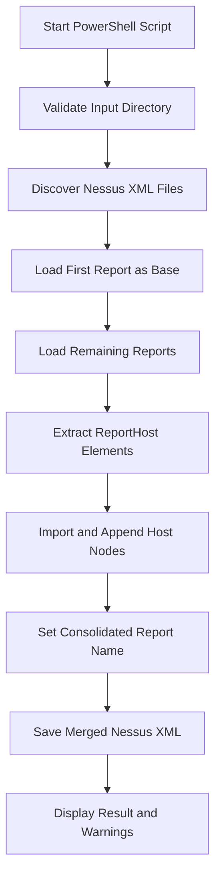

# Nessus Merge Tool

A lightweight, single-file PowerShell utility designed to consolidate multiple Tenable Nessus (`.nessus` v2) XML scan exports into a single unified report file.

---

## Table of Contents

- [Introduction](#introduction)
- [Why This Tool Exists](#why-this-tool-exists)
- [Key Features](#key-features)
- [Prerequisites](#prerequisites)
- [Installation and Setup](#installation-and-setup)
- [Quick Start](#quick-start)
- [Usage Examples](#usage-examples)
- [Architecture Overview](#architecture-overview)
- [XML and Nessus Report Concepts](#xml-and-nessus-report-concepts)
- [Processing Flow: Step by Step](#processing-flow-step-by-step)
- [Output and Terminal Messages](#output-and-terminal-messages)
- [Important Limitations](#important-limitations)
- [Troubleshooting](#troubleshooting)
- [Security and Privacy](#security-and-privacy)
- [Project Structure](#project-structure)
- [Future Improvements](#future-improvements)
- [License and Disclaimer](#license-and-disclaimer)

---

## Introduction

During vulnerability assessments and penetration tests, security practitioners frequently run scans across multiple network segments, cloud environments, or time windows. This often leaves analysts with several separate `.nessus` scan files.

Reviewing multiple files individually or importing them one by one into reporting platforms can be cumbersome. The **Nessus Merge Tool** solves this problem by providing a simple, reliable command-line script (`NessusMerge.ps1`) that merges all host entries from individual `.nessus` files into a single consolidated report.

### Core Capabilities at a Glance

- **Single-Script Utility**: Runs directly in PowerShell with no external packages, modules, or services required.
- **Automatic File Discovery**: Detects all `.nessus` scan reports in the target folder.
- **Safe XML Processing**: Hardened against XML External Entity (XXE) attacks using .NET `XmlReaderSettings`.
- **Output Isolation**: Automatically excludes the target output file from being re-processed as an input scan.
- **Original File Preservation**: Reads input scan files without modifying or deleting them.

---

## Why This Tool Exists

Large networks are typically scanned in batches—divided by subnets, physical locations, scan windows, or credentials. Each scan export yields an independent `.nessus` XML file. Managing these fragmented files manually introduces administrative overhead when generating client deliverables, conducting audits, or re-importing scan results into tools that accept consolidated Nessus files.

```text
scan-01.nessus
scan-02.nessus
scan-03.nessus
       |
       v
Nessus Merge Tool (NessusMerge.ps1)
       |
       v
merged_nessus_report.nessus
```

> **Important Clarification:**  
> This tool performs **structural file consolidation**. It does not perform active network scanning, does not remediate vulnerabilities, and does not prove that vulnerabilities identified across multiple scans have been resolved.

---

## Key Features

The features documented below reflect the actual implementation in `NessusMerge.ps1`:

- **Automatic Scan Discovery**: Locates all `.nessus` files within the target directory.
- **Configurable Input Folder**: Specify any directory via `-FilePath`, or default to the current working directory.
- **Configurable Output File**: Define a custom filename or absolute destination path via `-OutputFileName`.
- **Custom Report Name**: Update the internal `<Report name="...">` attribute via `-ReportName`.
- **Host-Record Appending**: Reads each report's `<ReportHost>` nodes and appends them to the base report document.
- **Informative Colored Terminal Output**: Displays color-coded terminal messages for progress (cyan), host additions (green), warnings (yellow), and errors (red).
- **Hardened XML Parser**: Prohibits DTD processing (`DtdProcessing.Prohibit`) and disables external entity resolution (`XmlResolver = $null`) to prevent XXE vulnerabilities.
- **Input File Preservation**: Input scans are opened in read-only streams and remain unchanged.

---

## Prerequisites

- **PowerShell Version**:
  - **Windows PowerShell 5.1** (standard on Windows 10/11 and Windows Server), or
  - **PowerShell 7+ (`pwsh`)** (cross-platform on Windows, Linux, and macOS).
- **Dependencies**: None. The tool utilizes built-in .NET XML libraries (`System.Xml.XmlDocument` and `System.Xml.XmlReader`).

### Check Your PowerShell Version

Run the following command in your terminal to verify your PowerShell version:

```powershell
$PSVersionTable.PSVersion
```

### Script Execution Policy (Windows)

On Windows systems, script execution may be restricted by default. To allow running local scripts in your current user session, execute:

```powershell
Set-ExecutionPolicy -ExecutionPolicy RemoteSigned -Scope CurrentUser
```

On Linux and macOS, launch the script directly using PowerShell 7:

```bash
pwsh -File ./NessusMerge.ps1
```

---

## Installation and Setup

1. **Clone the Repository** (replace `YOUR_USERNAME` with your actual GitHub username):

   ```powershell
   git clone https://github.com/YOUR_USERNAME/nessus-merge-tool.git
   cd nessus-merge-tool
   ```

2. **Verify Project Files**:
   Ensure `NessusMerge.ps1` is present in the working directory:

   ```powershell
   Get-ChildItem
   ```

---

## Quick Start

To merge all `.nessus` files located in your current folder using default settings, simply run:

```powershell
.\NessusMerge.ps1
```

### What Happens When You Run the Default Command:

1. **Target Folder Selected**: The script resolves the current directory (`(Get-Location).Path`).
2. **Files Discovered**: All files matching `*.nessus` in that folder are listed, excluding `merged_nessus_report.nessus`.
3. **Base Report Loaded**: The first discovered file is parsed as the base XML document.
4. **Host Records Appended**: `<ReportHost>` nodes from all subsequent `.nessus` files are imported and appended.
5. **Report Name Updated**: The `<Report>` attribute `name` is updated to `"Merged Report"`.
6. **File Saved**: The output document is saved as `merged_nessus_report.nessus` in the current folder.

---

## Usage Examples

### 1. Merge Files in the Current Directory

Runs with default settings in the current folder:

```powershell
.\NessusMerge.ps1
```

### 2. Specify an Input Directory

Scans a specific folder for `.nessus` files:

```powershell
.\NessusMerge.ps1 -FilePath "D:\NessusScans"
```

### 3. Specify a Custom Output Filename

Saves the merged report under a specific filename within the target directory:

```powershell
.\NessusMerge.ps1 `
  -FilePath "D:\NessusScans" `
  -OutputFileName "FinalReport.nessus"
```

### 4. Specify Custom Report Name and Output File

Customizes both the output filename and the internal report name attribute:

```powershell
.\NessusMerge.ps1 `
  -FilePath "D:\NessusScans" `
  -OutputFileName "FinalReport.nessus" `
  -ReportName "Consolidated Security Report"
```

### Parameter Reference

| Parameter | Type | Default Value | Purpose |
|---|---|---|---|
| `-FilePath` | `[string]` | `(Get-Location).Path` | Target folder containing `.nessus` scan files. Supports relative and absolute paths. Aliases: `-InputPath`, `-Path`. |
| `-OutputFileName` | `[string]` | `"merged_nessus_report.nessus"` | Filename or full path for the consolidated output file. If a filename is supplied, it is saved in `-FilePath`. Alias: `-OutputFile`. |
| `-ReportName` | `[string]` | `"Merged Report"` | Value assigned to the `name` attribute of the `<Report>` XML element in the merged file. |

---

## Architecture Overview

The project is built around a single-file architecture (`NessusMerge.ps1`) to ensure portability, zero installation overhead, and immediate execution in enterprise or field environments.



### Execution Stages

1. **Validation**: Confirms that the target directory exists and is accessible.
2. **Discovery**: Identifies candidate `.nessus` files while filtering out the destination output file path.
3. **Base Report Initialization**: Opens the primary `.nessus` file using secure .NET XML reader settings, providing the root structure, policies, and preferences.
4. **Iterative Host Appending**: Sequentially opens each additional report, extracts `<ReportHost>` nodes, imports them into the base document context, and appends them to `<Report>`.
5. **Metadata Update & Persistence**: Modifies the `<Report name="...">` attribute and writes the document to the destination file.
6. **Summary Reporting**: Returns a summary of host counts, file paths, and any non-fatal file read warnings.

---

## XML and Nessus Report Concepts

Tenable Nessus exports vulnerability scans in a specialized XML format known as **Nessus v2** (`NessusClientData_v2`). Understanding this structure clarifies how the merge operation works.

### Key Elements in Nessus XML

- **`<NessusClientData_v2>`**: The root XML element containing global configuration, scan policy data, and the report element.
- **`<Policy>`**: Scan policy preferences, plugins enabled, and engine settings used during the scan.
- **`<Report>`**: Container element that holds the scan title (`name` attribute) and all audited host nodes.
- **`<ReportHost>`**: Represents a single target scanned (e.g., an IP address or hostname). Contains host metadata (`<HostProperties>`) and individual findings.
- **`<ReportItem>`**: Represents an individual vulnerability check, service detection, or compliance finding associated with a specific `<ReportHost>`.

### Illustrative Nessus XML Structure

```xml
<!-- Synthetic illustrative example for documentation purposes -->
<NessusClientData_v2>
  <Policy>
    <policyName>Basic Network Scan</policyName>
  </Policy>
  <Report name="Example Scan">
    <ReportHost name="192.0.2.10">
      <HostProperties>
        <tag name="host-ip">192.0.2.10</tag>
        <tag name="host-fqdn">srv01.example.local</tag>
      </HostProperties>
      <ReportItem
        port="443"
        protocol="tcp"
        severity="2"
        pluginID="12345"
        pluginName="Example Finding">
        <description>Illustrative vulnerability description.</description>
      </ReportItem>
    </ReportHost>
  </Report>
</NessusClientData_v2>
```

> **How Merging Works:**  
> The tool merges reports at the **`<ReportHost>`** level. It does not inspect, compare, or deduplicate individual `<ReportItem>` nodes within those hosts.

---

## Processing Flow: Step by Step

Here is an in-depth look at what happens under the hood when `NessusMerge.ps1` executes:

1. **Parameter Initialization**: PowerShell parses user-supplied arguments or assigns default values (`$FilePath`, `$OutputFileName`, `$ReportName`).
2. **Input Directory Validation**: `Test-Path` checks whether `$FilePath` exists and is a directory (`Container`). If not, the script prints an error and exits immediately.
3. **Output Path Calculation**: If `$OutputFileName` is an absolute path, it is used directly; otherwise, it is joined with the target folder via `Join-Path`. The full path is resolved using `[System.IO.Path]::GetFullPath()`.
4. **File Discovery & Output Exclusion**: `Get-ChildItem` discovers all `*.nessus` files. Any file matching the resolved output path is excluded so existing output reports are not re-ingested.
5. **Safe XML Loading (`Load-SafeXmlDocument`)**: Files are parsed using `System.Xml.XmlReaderSettings`. External entity resolution (`XmlResolver = $null`) and DTD parsing (`DtdProcessing.Prohibit`) are explicitly disabled to prevent XXE exploitation.
6. **Base Report Selection**: The first file in the array (`$files[0]`) is loaded. The script confirms that a `<Report>` node exists and records the initial host count.
7. **Host Extraction and Appending**:
   - For each subsequent file, the script loads the XML document.
   - It queries all `<ReportHost>` nodes via XPath (`//Report/ReportHost`).
   - Using `$baseDoc.ImportNode($hostNode, $true)`, it clones each host into the base document context and appends it to the base `<Report>`.
   - Host counts are tracked and reported in real-time.
8. **Report Name Update**: The `<Report>` node's `name` attribute is updated to match `$ReportName`.
9. **Saving Output**: The base XML document, now containing all appended host nodes, is written to `$outputFilePath` using `$baseDoc.Save()`.
10. **Terminal Summary**: Outputs the total count of merged hosts, the output file location, and notices for any files that encountered warnings or read errors.

---

## Output and Terminal Messages

When running `NessusMerge.ps1`, the script provides clear, color-coded terminal feedback.

### Illustrative Terminal Output

```text
Found 3 .nessus file(s) in 'D:\NessusScans':
  - scan-01.nessus
  - scan-02.nessus
  - scan-03.nessus

Loading base report: scan-01.nessus
  Base report loaded with 6 host(s).
Processing: scan-02.nessus
  Added 4 host(s) from scan-02.nessus.
Processing: scan-03.nessus
  Added 2 host(s) from scan-03.nessus.

Setting report name to: 'Consolidated Security Report'
Saving merged report to: 'D:\NessusScans\FinalReport.nessus'

[SUCCESS] Successfully merged 12 host(s) into 'D:\NessusScans\FinalReport.nessus'.
```

*(Note: File names, host counts, and directory paths in this example are illustrative and will match your actual environment.)*

---

## Important Limitations

To set proper expectations, users should understand the following technical boundaries of the current implementation:

- **Host Appending Without Deduplication**: The script appends all `<ReportHost>` elements. If the same IP address or hostname was scanned in multiple input files, it will appear multiple times as separate `<ReportHost>` records in the merged report.
- **Base Report Metadata Dependency**: The `<Policy>` configuration, scanner preferences, and scan timestamps are inherited exclusively from the first (base) report. Metadata from subsequent reports is not combined.
- **No Finding Deduplication**: The tool does not compare or deduplicate individual `<ReportItem>` findings.
- **Import Acceptance Not Guaranteed**: While the output is valid Nessus v2 XML, compatibility depends on your specific Nessus software version and whether differing scan policies or plugin sets exist across your files. Always test re-importing on a representative sample.
- **File Overwrite Behavior**: If a file with the target output name already exists, saving the merged document will overwrite it without an interactive confirmation prompt.
- **Partial Processing on Errors**: If an individual secondary file has corrupted XML, it is reported with an error message and skipped, while valid reports are still merged and saved with a warning message.
- **No Assessment or Remediation**: This utility only manipulates XML files. It does not scan networks or verify vulnerability fixes.

---

## Troubleshooting

### 1. `[WARN] No .nessus files found in '...'`
- **Cause**: The input directory contains no files with the `.nessus` extension (case-insensitive), or the only matching file is the designated output file.
- **Resolution**: Check your `-FilePath` parameter to ensure it points to the directory containing your `.nessus` exports.

### 2. `[ERROR] Input folder does not exist: ...`
- **Cause**: The directory path supplied to `-FilePath` could not be found or is inaccessible.
- **Resolution**: Verify folder spelling, path separators, and drive letters. Use quotation marks for paths with spaces (e.g., `-FilePath "C:\My Scans"`).

### 3. `[ERROR] Invalid Nessus file: No <Report> element found`
- **Cause**: The file is not a valid Nessus v2 XML export or is empty.
- **Resolution**: Confirm that your scan was exported in Nessus XML format (`.nessus`) and not as a CSV, HTML, or Nessus DB file.

### 4. `[ERROR] Failed to load ...: Exception calling "Load" with "1" argument(s)`
- **Cause**: Malformed XML syntax or an unexpected file format.
- **Resolution**: Open the problematic `.nessus` file in an XML or text editor to verify that tags are properly closed and valid UTF-8 encoding is used.

### 5. Script Execution Policy Error (`PSSecurityException`)
- **Cause**: Windows PowerShell default security policy restricts executing unsigned scripts.
- **Resolution**: Execute `Set-ExecutionPolicy -ExecutionPolicy RemoteSigned -Scope CurrentUser` in PowerShell.

### 6. Access Denied or File In Use Errors
- **Cause**: The destination file is open in another program or the user lacks write permissions to the output folder.
- **Resolution**: Close any programs (such as editors or viewers) using the output file and check your folder permissions.

---

## Security and Privacy

Tenable Nessus XML scan reports contain highly confidential infrastructure intelligence, including:
- Internal and public IP addresses, hostnames, and MAC addresses.
- Operating system versions and running services.
- Detailed vulnerability descriptions, CVE references, and exploitation proof.
- Network topology and configuration details.

### Recommended Operational Practices

- **Never Commit Scan Data**: Never commit `.nessus` files or generated reports to public or unencrypted version control repositories.
- **Verify `.gitignore`**: Ensure your `.gitignore` file includes `*.nessus` to prevent accidental commits of assessment data.
- **Use Synthetic Data in Demos**: Never use real client or enterprise scan files in screenshots, public documentation, or bug reports.
- **Restricted Storage**: Store generated merged reports in encrypted volumes with restricted file-system permissions.
- **Authorization**: Only merge and analyze scan reports for systems you have explicit, documented authorization to assess.

---

## Project Structure

```text
nessus-merge-tool/
├── NessusMerge.ps1
└── README.md
```

| File | Purpose |
|---|---|
| `NessusMerge.ps1` | The complete, self-contained PowerShell utility containing parameter handling, XML parsing, host-merging logic, and terminal output. |
| `README.md` | Comprehensive user guide, architectural documentation, and usage instructions. |

---

## Future Improvements

The following capabilities are **not currently implemented** but represent potential future enhancements:

- **Host Deduplication**: Merging multiple scan results for the same IP or FQDN into a single `<ReportHost>` entry.
- **Finding Consolidation**: Conservative deduplication of duplicate `<ReportItem>` findings across scans.
- **Interactive Overwrite Prompts**: Adding confirmation prompts or a `-Force` switch before overwriting existing output files.
- **Staging / Temporary Write**: Writing to a `.tmp` file and validating XML schema compliance before replacing the target file.
- **Detailed Statistical Summaries**: Generating vulnerability counts by severity (Critical, High, Medium, Low, Info) in the terminal summary.
- **Transactional Rollback**: Rolling back changes if any secondary file fails to process.

---

## License and Disclaimer

### License

A license for this project has not yet been specified. If you plan to distribute or accept external contributions to this project, consider adding an appropriate open-source license (such as the MIT License or Apache 2.0).

### Disclaimer

This tool is an independent utility developed for authorized security assessment workflows. It is **not affiliated with, sponsored by, or endorsed by Tenable, Inc.** "Nessus" is a registered trademark of Tenable, Inc.
